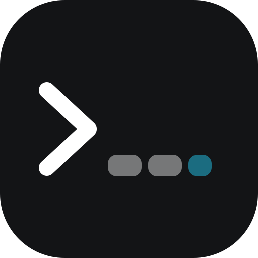
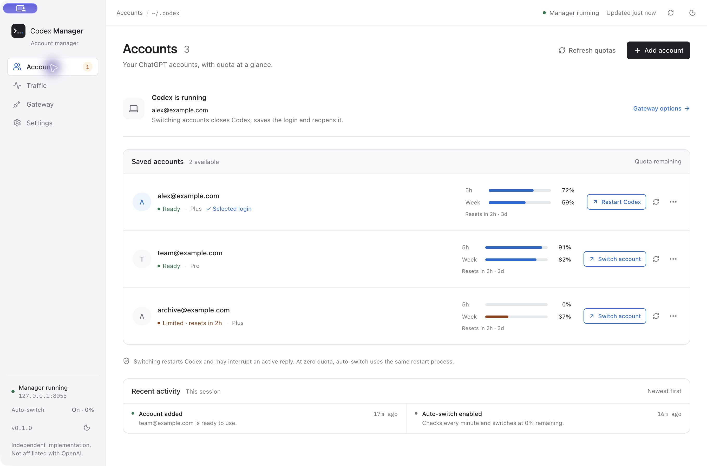
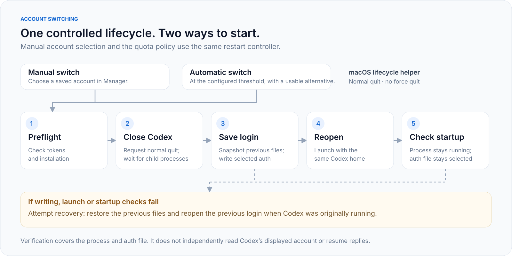
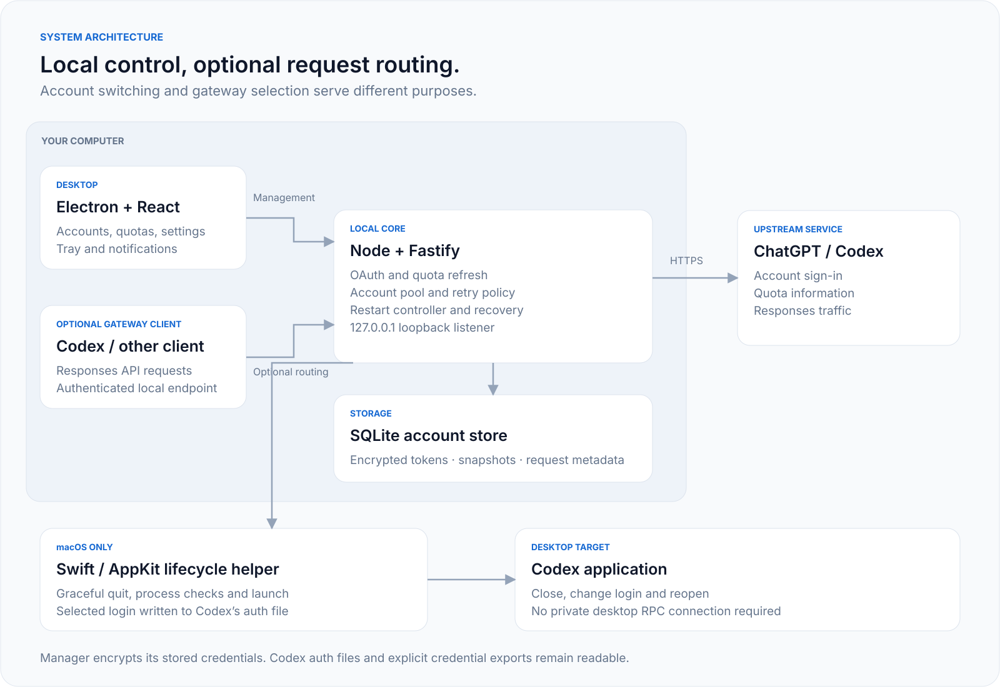
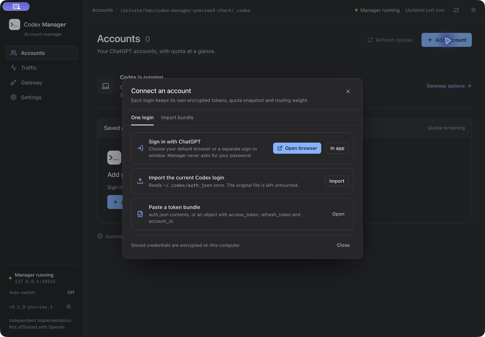
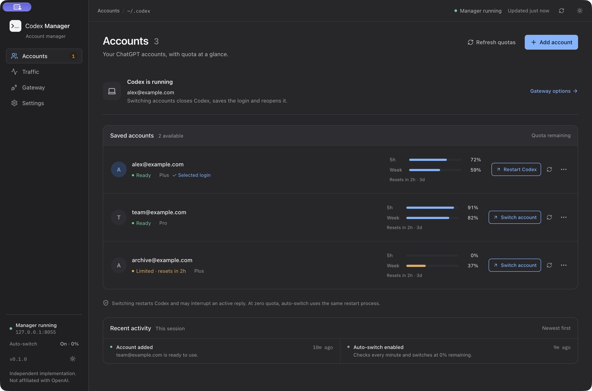
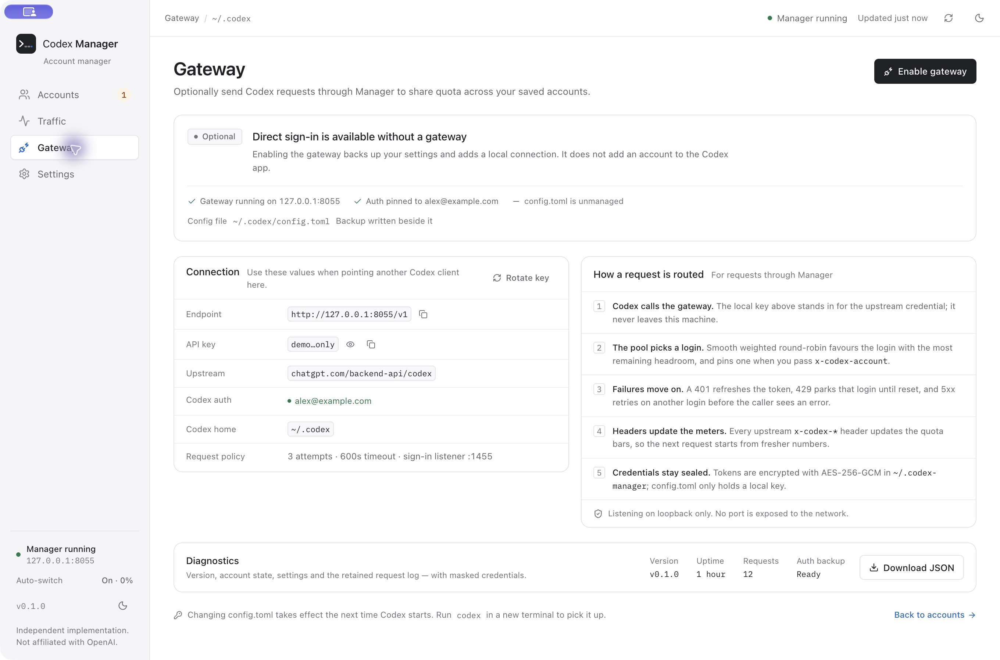
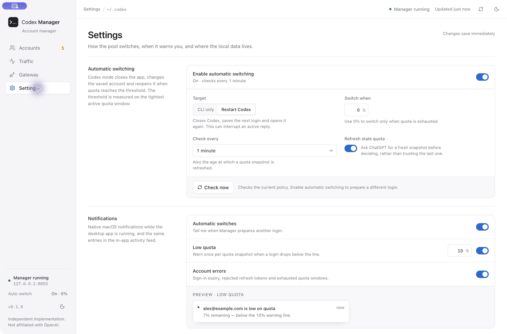
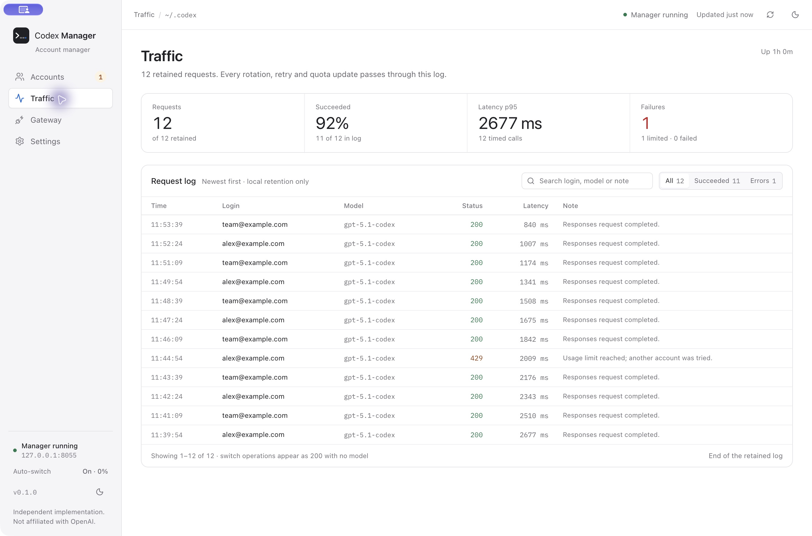

<p align="center">
  
</p>
<h1 align="center">Codex Manager</h1>
<p align="center">Your Codex accounts, quotas and local routing in one desktop app.</p>
<p align="center">
  <a href="https://github.com/GruffDuck/codex-manager/releases/tag/v0.1.0-preview.4"></a>
  <a href="LICENSE"></a>
  <a href="docs/validation.md"></a>
</p>
<p align="center">
  <a href="#download">Download</a> · <a href="#getting-started">Getting started</a> · <a href="#screenshots">Screenshots</a> · <a href="#documentation">Documentation</a>
</p>



<p align="center"><sub>Native desktop screenshot with synthetic demonstration accounts. No personal account data is shown.</sub></p>

Codex Manager keeps multiple ChatGPT/Codex logins on your computer, shows their
reported quotas and helps you choose the next account. On macOS, switching can
close Codex, save the selected login and reopen Codex. An optional local gateway
can distribute Responses API requests across eligible accounts.

> **Preview software.** macOS Apple Silicon packages have passed a packaged
> startup check. Windows x64 packages are available for testing, but Windows
> installation and startup have not yet been validated. Automatic Codex
> close/reopen is currently **macOS-only**. Packages are unsigned; macOS packages
> are not notarized.

## Contents

- [Download](#download)
- [What it does](#what-it-does)
- [Platform support](#platform-support)
- [Getting started](#getting-started)
- [Account switching](#account-switching)
- [Optional gateway](#optional-gateway)
- [Screenshots](#screenshots)
- [Privacy and local storage](#privacy-and-local-storage)
- [Build from source](#build-from-source)
- [Documentation](#documentation)
- [License and attribution](#license-and-attribution)

## Download

| Platform | Installer | Alternative |
| --- | --- | --- |
| macOS Apple Silicon | [Download DMG](https://github.com/GruffDuck/codex-manager/releases/download/v0.1.0-preview.4/Codex.Manager-0.1.0-preview.4-mac-arm64.dmg) | [Download ZIP](https://github.com/GruffDuck/codex-manager/releases/download/v0.1.0-preview.4/Codex.Manager-0.1.0-preview.4-mac-arm64.zip) |
| Windows x64 · testing preview | [Download Setup EXE](https://github.com/GruffDuck/codex-manager/releases/download/v0.1.0-preview.4/Codex.Manager-Setup-0.1.0-preview.4-win-x64.exe) | [Download ZIP](https://github.com/GruffDuck/codex-manager/releases/download/v0.1.0-preview.4/Codex.Manager-0.1.0-preview.4-win-x64.zip) |

[Release notes](https://github.com/GruffDuck/codex-manager/releases/tag/v0.1.0-preview.4)
· [SHA-256 checksums](https://github.com/GruffDuck/codex-manager/releases/download/v0.1.0-preview.4/SHA256SUMS.txt)
· [All releases](https://github.com/GruffDuck/codex-manager/releases)

Node.js is included in the desktop packages. You do not need Node or npm to use
an installer. Extract the complete Windows ZIP before opening the app; copying
only the EXE will omit required files.

## What it does

| Feature | What you get |
| --- | --- |
| Multiple accounts | Sign in, import an existing Codex login or import a credential bundle. |
| Quota visibility | Remaining quota, reset times and plan information reported by the upstream service. |
| Account switching | On macOS, a controlled close, login update and reopen sequence. |
| Automatic switching | On macOS, the same restart sequence when the selected login reaches your quota threshold. |
| Local gateway | Optional quota-weighted routing, token refresh and retries for Responses API requests. |
| Desktop utilities | Menu-bar access, configurable notifications, light/dark themes and request history. |
| Import and export | Account metadata, explicitly requested credential exports and diagnostics. |

Quotas are reported values, not estimates. A saved login, the account shown in
Codex and the account selected for a gateway request are different states;
Manager does not treat them as interchangeable.

## Platform support

| Capability | macOS Apple Silicon | Windows x64 | Linux |
| --- | --- | --- | --- |
| Downloadable package | DMG / ZIP | Setup EXE / ZIP | Build targets only |
| Packaged startup validation | Passed | Not yet run | Not yet run |
| Account, quota and gateway UI | Included | Included; awaiting platform testing | Source build |
| Automatic Codex close/reopen | Implemented; real switch cycle still pending | Not implemented | Not implemented |
| Signed release / auto-update | Not available | Not available | Not available |

See [validation](docs/validation.md) for the exact checks performed.

## Getting started

1. Install the package for your platform and open Codex Manager.
2. Select **Add account**. Sign in with ChatGPT or import an existing Codex login.
3. Refresh quotas to confirm each account's reported availability.
4. On macOS, select **Switch account** to close Codex, save that login and reopen it.
5. To switch at quota exhaustion, open **Settings**, choose **Restart Codex**, set
   the threshold to **0%**, choose the check interval and enable automatic switching.

Automatic switching is off by default on a fresh installation. The default
threshold is 0%, with a 60-second check interval. A usable alternative account
with known remaining quota is required. If Codex is already closed, automatic
switching leaves it closed.

## Account switching



The account is checked before Codex is asked to quit. Manager waits for Codex
and its child processes to exit before writing credentials. A refused quit
leaves the login unchanged. If reopening or startup checks fail, Manager tries
to restore the previous files and reopen the previous session.

Switching can interrupt an active reply. Startup confirmation checks that Codex
is running and the selected login remains in its auth file; it does **not**
independently read the account displayed inside a private Codex desktop session.
It also does not automatically resume an interrupted conversation.

[Switching behavior and recovery](docs/desktop-integration.md)

## Optional gateway



Enable the gateway from **Gateway** when you want eligible accounts to share
Responses API traffic. Manager backs up your Codex configuration and writes a
local provider. Restart Codex to load that provider. You can restore the previous
configuration from the same page.

The gateway selects accounts per request using quota-weighted round-robin. It
refreshes rejected tokens once, cools down rate-limited accounts and retries
eligible failures within the configured attempt limit. Gateway routing does
not change the account displayed in the Codex desktop app.

[Gateway configuration and API reference](docs/gateway.md)

## Screenshots

These images were captured from a **native Electron application window**. The
account, settings, gateway and traffic images use a read-only demonstration
backend with synthetic accounts and requests. The sign-in image uses the real
Preview 3 package in an empty temporary profile. They are not browser
screenshots or generated UI mockups.

<details>
<summary><strong>Browser and in-app sign-in</strong></summary>



</details>

<details>
<summary><strong>Accounts in dark mode</strong></summary>



</details>

<details>
<summary><strong>Gateway settings</strong></summary>



</details>

<details>
<summary><strong>Automatic switching and notifications</strong></summary>



</details>

<details>
<summary><strong>Request history</strong></summary>



</details>

## Privacy and local storage

Account credentials stored by Manager are encrypted with AES-256-GCM. The local
key is stored separately from the SQLite database. The gateway and management
API listen on `127.0.0.1`; gateway requests require a local API key. Management
requests are restricted to local hostnames and matching browser origins.

| Location | Purpose |
| --- | --- |
| `~/.codex-manager/data.db` | Accounts, encrypted credential bundles, quotas and request history. |
| `~/.codex-manager/secret.key` | Local encryption key. Keep it private and back it up with the database. |
| `~/.codex-manager/config.json` | Gateway configuration and local API key. |
| `$CODEX_HOME/auth.json` | Codex's selected login; defaults to `~/.codex/auth.json`. |

Codex's auth file and credential exports contain readable credentials; Manager's
at-rest encryption does not encrypt those files. Metadata exports omit tokens.
Do not publish credential exports, auth files, the database or the local key.

[Security policy](SECURITY.md)

## Build from source

Use Node.js 24 and npm. Building the macOS lifecycle helper also requires Xcode
Command Line Tools. Binary packages include the runtime and compiled helper.

```sh
git clone https://github.com/GruffDuck/codex-manager.git
cd codex-manager
npm ci
npm run dev
```

| Command | Purpose |
| --- | --- |
| `npm run dev` | Start the core and development UI. |
| `npm run desktop` | Build and run the native Electron shell. |
| `npm test` | Run unit, mock gateway and lifecycle tests in isolated profiles. |
| `npm run typecheck` | Check core and UI TypeScript. |
| `npm run package` | Package the host macOS/Linux target. |
| `npm run package:win` | Build Windows x64 Setup EXE and ZIP. |

[Build and packaging guide](docs/packaging.md) · [Contribution guide](CONTRIBUTING.md)

## Documentation

- [Changelog](CHANGELOG.md)
- [Feature guide](docs/features.md)
- [Account switching and automatic restart](docs/desktop-integration.md)
- [Gateway configuration and API](docs/gateway.md)
- [Build, packaging and signing](docs/packaging.md)
- [Architecture and the Electron/Rust trade-off](docs/architecture.md)
- [Validation record](docs/validation.md)
- [Source provenance review](docs/provenance-audit.md)
- [Third-party notices](THIRD_PARTY_NOTICES.md)

## License and attribution

Project contributions are licensed under **CC BY-NC-SA 4.0**. Noncommercial use,
modification and sharing are permitted subject to attribution, change notices
and share-alike requirements. Commercial use is not granted by this license.
Third-party components retain their own licenses.

Because commercial use is restricted, this project is **source-available**,
rather than open source under the OSI definition. Creative Commons licenses are
not specifically designed for software; this license is the project owner's
choice. Read the [full license](LICENSE) and [third-party notices](THIRD_PARTY_NOTICES.md).

The architecture was inspired by Antigravity Manager. A local comparison found
no clear copied application implementation, but it is not a proof of complete
originality; the [review](docs/provenance-audit.md) documents its scope and limits.

Codex Manager is an independent project and is not affiliated with or endorsed
by OpenAI or Antigravity Manager.
