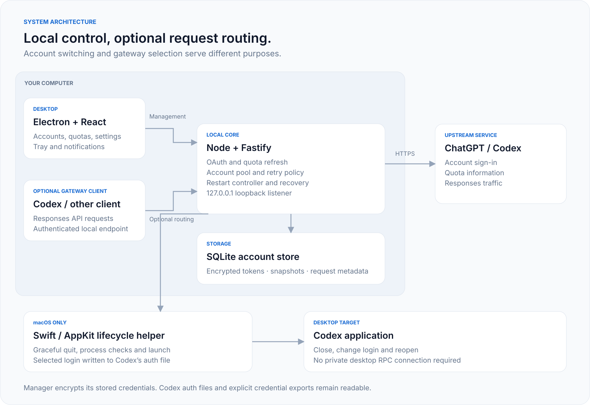

# Architecture and framework decision

## Components

| Component | Responsibility |
| --- | --- |
| React / TypeScript UI | Accounts, quota meters, activity, gateway configuration and settings. |
| Electron main process | Application windows, tray access, notifications and local core startup. |
| Node / Fastify core | Management API, OAuth, quota refresh, account selection, Responses gateway and persistence. |
| SQLite vault | Account metadata, encrypted credential bundles, settings and retained request metadata. |
| macOS Swift helper | Discover Codex, request a graceful quit and launch it with the selected home. |

The desktop shell and core are separate processes. The shell checks API compatibility before using an existing core. The local management API and optional gateway share a loopback listener, with different access rules. See [security](../SECURITY.md) and [gateway details](gateway.md).

Three account states must remain distinct: the saved login in Codex's auth file, the account displayed by an already-running Codex instance, and the account used for one gateway request. Writing a file does not prove that a running application has loaded it. The restart controller addresses this with an explicit quit/write/launch sequence, with the verification limits documented in [desktop integration](desktop-integration.md).

## Why Electron for this preview

Electron provides a Node main process, separate Chromium renderer processes and native window/tray APIs. This supports the existing TypeScript UI and core with a consistent rendering environment. Its bundled runtime carries a package-size cost. See the official [Electron process model](https://www.electronjs.org/docs/latest/tutorial/process-model).

For this project, keeping Electron through preview is an engineering choice: the immediate gaps are real restart-cycle validation, Windows lifecycle support, signing and platform testing. Rewriting the shell does not itself solve those integration gaps.

## Would Rust / Tauri be better?

Tauri combines a Rust core with platform WebViews instead of bundling a browser engine. That makes it a candidate for reducing the desktop shell's distribution footprint, with platform-specific rendering behavior to test. See the official [Tauri architecture](https://v2.tauri.app/concept/architecture/).

A Tauri shell could retain the React UI and initially run the Node core as a sidecar. That would still ship Node, so a shell-only migration would not remove all runtime overhead. Moving the core into Rust would also require ports of token refresh, encryption, SQLite access, streaming, retry policy and recovery behavior.

No Tauri prototype or comparative resource measurements exist for this project. A migration should be justified by measured package size, memory, startup time and platform behavior, then validated against the current tests. The current decision is to finish the preview's integration and distribution checks before committing to a rewrite.
