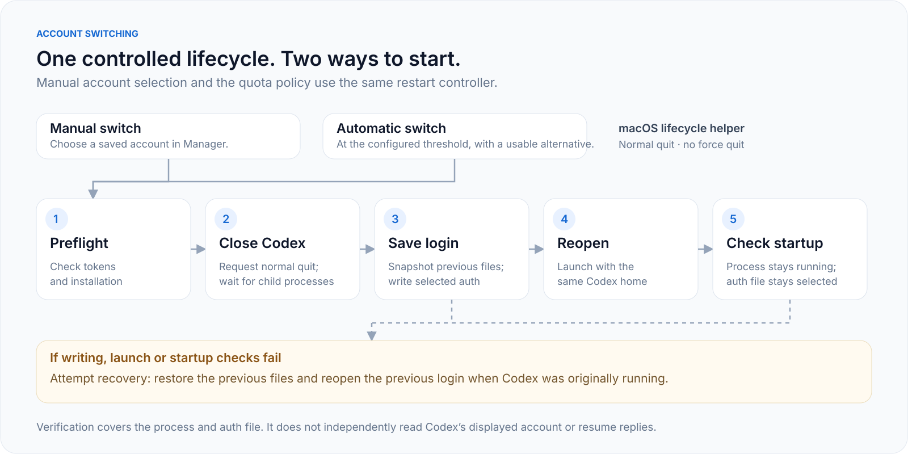

# Account switching and automatic restart

## User flow

The primary account button and automatic switching use the same `RestartController`:

1. Validate the selected account's tokens and locate Codex.
2. Request a normal quit through macOS AppKit.
3. Wait for the application and its child processes to exit. No force quit is used.
4. Encrypt a snapshot of the current authentication and configuration files.
5. Atomically write the selected login to `auth.json`. Remove Manager's gateway provider when present, preparing direct ChatGPT sign-in.
6. Open Codex with the same `CODEX_HOME`.
7. Across three startup checks, confirm that Codex remains running and the auth file still contains the selected login. Only then record completion.

The primary flow does not require a live RPC connection to Codex's server. An older experimental shared-server bridge remains in the source but is not used by the primary button or automatic switching.

## API and progress

| Endpoint | Behavior |
| --- | --- |
| `POST /api/accounts/:id/use-in-codex` | Close, save the login and reopen. |
| `GET /api/codex/restart` | Support, installation, running state and latest operation. |
| `GET /api/state` | Includes `codex_restart` for the UI. |
| `POST /api/accounts/:id/prepare` | Prepare files for a later manual launch. |
| `POST /api/accounts/:id/use-in-cli` | Update the CLI login file only. |
| `POST /api/accounts/:id/live-switch` | Experimental shared-server path; not used by the primary UI. |

Progress states are `preparing`, `closing`, `writing`, `opening`, `checking`, `completed` and `failed`. The UI disables competing account actions during an operation. A core mutation lock also prevents CLI writes from overlapping a restart.

## Automatic switching

Automatic switching is disabled by default. The **Restart Codex** target watches the tightest active quota window of the login selected in Codex's auth file. Defaults are a **0%** threshold and a **60-second** check interval. An alternative must be usable and have known headroom above the threshold; unknown quotas do not qualify.

If Codex is closed, the automatic policy leaves it closed. If no managed login is selected, the user must select one first. The policy does not wait for an active reply to finish, so a restart can interrupt work.

Failures create an activity entry and, when enabled, a notification. Automatic retries for the same target pause for at least ten minutes; manual retries remain available. A competing mutation defers the check. **CLI only** changes the login file without restarting the desktop app.

## Failure and recovery

- Token refresh or installation detection failures leave the running app untouched.
- A refused quit or remaining child process prevents credential changes.
- Write, launch or startup-check failures trigger a recovery attempt: close a partially opened instance when necessary, restore previous files, and reopen the previous login if Codex was originally running.
- A failed recovery is reported explicitly.
- Recovery snapshots use AES-256-GCM in the database and are cleared after successful completion or recovery. Automatic recovery after a full process or machine crash is not implemented; interrupted operations are shown as failed in Manager.

## Platform and verification limits

The native lifecycle helper currently supports **macOS only**. It locates the app by `com.openai.codex`; unrelated apps and independent CLI sessions are not sent quit requests. Building the helper requires Swift and Xcode Command Line Tools; binary packages include the compiled helper.

Startup confirmation verifies **process state and the auth file**. It does not independently query the account displayed in a private Codex desktop server and does not resume conversations.

The test suite covers sequencing, rejected quits, rollback, unexpected auth changes, concurrency and the shared manual/automatic controller. A real native status query located the installed running Codex app. A real close/change/reopen cycle has not yet been run because it would close the active development chat. See the [validation record](validation.md).
